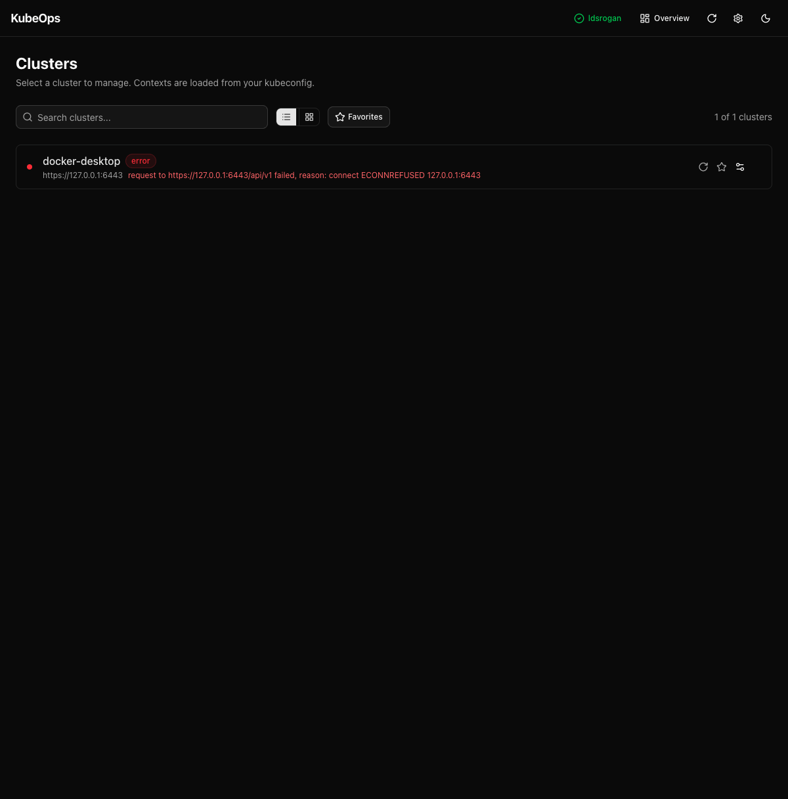
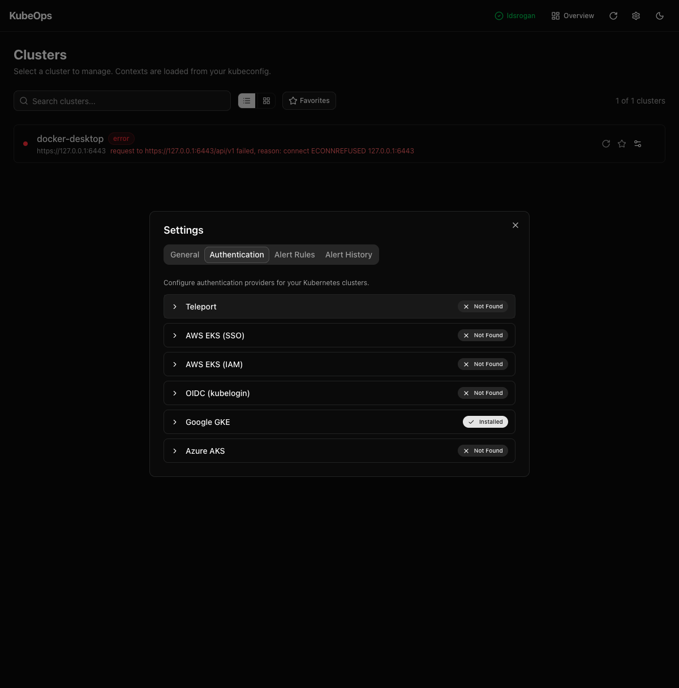
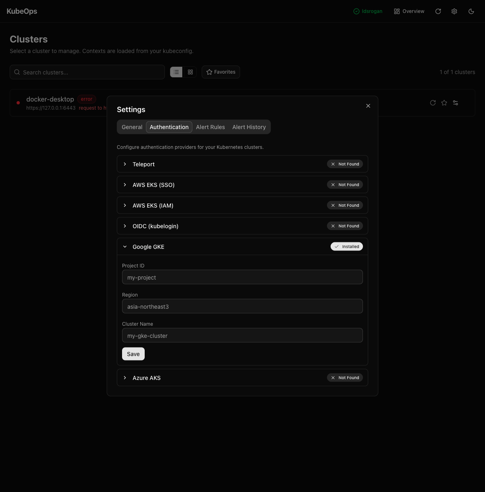

# v0.7.1 — Alert Scope & Test Discovery

## Changed

- **Alert rules state their scope.** They are evaluated from the Watch stream of
  the cluster you have open — reusing that page's connection instead of holding
  one open per rule-bearing cluster. Settings → Alert Rules now marks each rule
  **Active**, **Paused** or **Off**, and names the cluster you would need to
  open to resume a paused one. The previous behaviour was the same scope with no
  indication of it anywhere.

## Fixed

- **Tests were silently skipped.** Node's test runner reads `--test` arguments
  as glob patterns, and App Router paths contain `[param]` segments that are
  glob character classes — so `route.test.ts` under
  `[clusterId]/[appName]` matched nothing and never ran, without an error. The
  runner now imports discovered files directly, and a guard test fails if
  discovery ever misses a file in the working tree again.

## Internal

- Extracted manifest parsing, delete propagation-policy validation and alert
  scope into testable modules. 196 -> 232 tests.

# v0.7.0 — Correctness, Safety & UX Pass

A broad review-driven release. No new surface area; a lot of things that quietly
did the wrong thing now do the right one.

## Fixed

- **Cascade delete honours the propagation policy.** Choosing "Orphan" or
  "Foreground" in the delete dialog had no effect — every delete used the server
  default. The selected policy is now sent and validated.
- **Log and terminal tabs no longer collide across clusters.** Tab identity
  ignored cluster and namespace, so opening logs for `web-0` in two clusters
  reused one tab and showed the wrong cluster's output under the right label.
- **A malformed log URL no longer takes the backend down.** An invalid
  percent-escape threw out of the WebSocket handler and killed the server
  process, leaving a dead window with no explanation.
- **Cross-site requests to the local API are rejected.** Any page in any browser
  on the machine could reach `http://localhost:51230` and trigger state-changing
  requests without a CORS preflight. All non-GET API requests now require a
  same-origin `Origin`.
- **Port-forward processes are cleaned up on quit.** The shutdown hook was
  reading an empty copy of the registry, so `kubectl port-forward` children
  outlived the app and kept holding their ports.
- **Watch streams no longer leak.** Unsubscribing while a watch was still being
  established left the connection open to the API server forever.
- **Windows and Linux CLI discovery works.** Tool lookup was hardcoded to
  `which -a` with `/usr/local/bin` fallbacks, which made Helm unusable on
  Windows. Lookup is now platform-aware.
- **Kubeconfig edits take effect immediately.** Merging, adding, renaming or
  deleting a context did not invalidate any of the caches, so the UI kept
  serving pre-edit data for up to a minute.
- **Only one KubeOps instance runs at a time**, and startup verifies that the
  server on port 51230 is actually ours instead of loading whatever is there.
- **Non-ASCII log output is no longer mangled.** Log chunks were decoded per
  network chunk, splitting multi-byte characters.
- **Log search counts match what is highlighted.** Matches were counted in the
  raw log but highlighted in escaped HTML, so the "n of m" counter and the
  navigation disagreed for anything containing `<`, `>` or `&`.
- Resource kind labels no longer read "ingresse" or "networkpolicie".
- "View Logs" / "Exec" report why they cannot open instead of doing nothing.

## Improved

- **Alert rule scope is now visible.** Rules are evaluated from the open
  cluster's Watch stream; ones targeting another cluster show as *Paused* in
  Settings instead of silently doing nothing.
- **Port forwards are polled**, and a tunnel that dies (pod restart, connection
  drop) now says so instead of staying green.
- **Downloading logs fetches the pod's full log** from the cluster rather than
  silently saving the trimmed on-screen buffer, which is now marked as trimmed.
- **Log rendering is incremental.** Each chunk is converted once instead of
  re-parsing the whole 512 KB buffer on every frame.
- **Cluster health checks respect their cache.** Two independent code paths were
  re-probing every context in the kubeconfig every 30 seconds.
- **Table state persists** — sorting, hidden columns, page size and density are
  remembered per resource type.
- **Bulk delete**: select rows and delete them together.
- **Multi-document YAML** is supported in multi-cluster apply, with per-document
  results.
- **The command palette searches the whole list.** Namespaces were capped at 10
  and objects at 50 *before* filtering, making the rest unreachable.
- **Shortcut hints show `Ctrl` on Windows and Linux** instead of always `⌘`.
- **Automatic sign-in on launch is now opt-in** (Settings → General → Sign-in);
  it used to open a browser window unprompted on first run.
- **The YAML editor** confirms before discarding edits, hides the server-owned
  `status` block, and offers to reload when a save conflicts.
- HTTP requests time out instead of spinning forever against an unreachable
  cluster; long-running Helm and apply operations get a longer budget.
- WebSocket streams apply backpressure; exec sessions have a server-side
  keepalive so a dropped connection cannot strand a `kubectl exec`.
- Accessibility: icon-only buttons have accessible names, and
  `prefers-reduced-motion` is honoured.
- Route-level error boundaries keep a failing view from blanking the whole app.
- A failed macOS in-place update now restores the previous app bundle.

## Developer

- `npm test`, `npm run typecheck` and `npm run verify` exist; CI runs them on
  every pull request and gates releases on them.
- macOS Intel (`x64`) builds are produced again — the README documented them but
  the build config only emitted `arm64`.

# v0.6.0 — ArgoCD Login & Chart Sync

## What's New

- Added ArgoCD as an authentication provider: log in to your ArgoCD server (SSO browser flow) directly from KubeOps via the `argocd` CLI — no terminal needed. Auth is delegated to your `argocd login` session; KubeOps stores no tokens.
- Added a "Sync to Latest" action for ArgoCD Applications backed by a Helm chart, on both the Applications list and the app detail page. It checks whether the app is out of sync and, on confirmation, triggers an ArgoCD sync.
- The sync dialog shows current vs. target revision and offers inline ArgoCD login when the CLI session is missing.
- CLI arguments derived from user input are validated to prevent argv flag smuggling.

## Notes

- Applications with a floating `targetRevision` (e.g. `1.2.*`, ranges) are fully supported. Applications pinned to an exact chart version currently show an informational "not yet supported" message; bumping a pinned version to the latest is planned for a follow-up.
- Requires the optional `argocd` CLI on your `PATH`.

# v0.4.6 — Helm Sync Latest

## What's New

- Added Helm release sync actions that upgrade a release to the latest chart version from configured Helm repositories.
- Added release-level sync entry points from the Helm list and detail pages.
- Added Pod-to-Helm-release navigation when Helm metadata can identify the owning release.
- Added a Cluster overview shortcut to Helm releases.
- Skips Helm upgrade when the release is already on the latest detected chart version.

# v0.3.0 — Multi-Provider Authentication

## Highlights

KubeOps now supports **6 authentication providers** out of the box. No more switching to the terminal to re-authenticate — KubeOps detects your cluster's auth provider from kubeconfig and handles login directly.

### Supported Providers

| Provider | CLI | What it does |
|----------|-----|-------------|
| **Teleport** | `tsh` | Proxy login + per-cluster `kube login` |
| **AWS EKS (SSO)** | `aws` | SSO browser login + kubeconfig update |
| **AWS EKS (IAM)** | `aws` / `aws-iam-authenticator` | Credential verification |
| **OIDC** | `kubelogin` | Browser-based OIDC token refresh |
| **Google GKE** | `gcloud` | Google auth + cluster credentials |
| **Azure AKS** | `az` | Azure login + AKS credentials |

## What's New

### Multi-Provider Auth Framework
- **Auto-detection**: Analyzes kubeconfig `exec` commands and server URLs to identify which provider manages each cluster
- **Unified Settings**: New **Authentication** tab in Settings shows all providers with install status and configuration fields
- **Header login buttons**: Only installed providers appear in the header, showing logged-in username when authenticated
- **Provider-aware cluster login**: Clicking a disconnected cluster routes to the correct provider automatically
- **Provider-aware error recovery**: Auth error pages show a login button for the detected provider

### Architecture
- Provider-per-module pattern with common `AuthProvider` interface
- Unified API routes (`/api/auth/[providerId]/status`, `/api/auth/[providerId]/login`)
- Safe CLI execution via `execFileSync` (no shell injection)
- Input validation on all API endpoints
- Legacy `/api/tsh/*` routes preserved for backward compatibility

## Screenshots

### Cluster page with provider login status


### Authentication providers in Settings


### Provider-specific configuration


## Breaking Changes

- The Teleport (tsh) configuration has moved from **Settings > General** to **Settings > Authentication**. Existing settings are preserved in localStorage.

## Requirements

No new required dependencies. Auth providers are optional — install the CLI tools for the providers you use:

```bash
# AWS EKS
brew install awscli

# Google GKE
brew install google-cloud-sdk

# Azure AKS
brew install azure-cli

# OIDC
kubectl krew install oidc-login

# Teleport
brew install teleport
```
